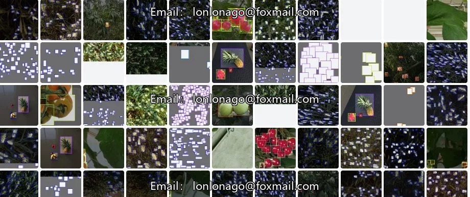
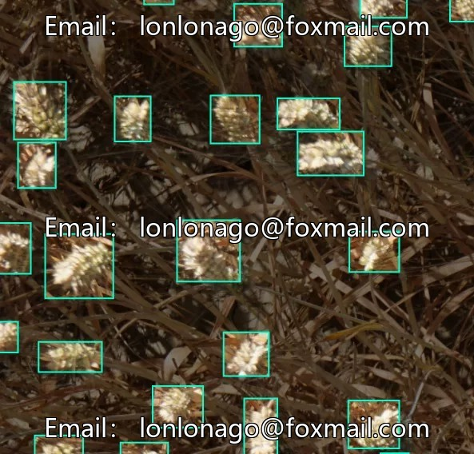
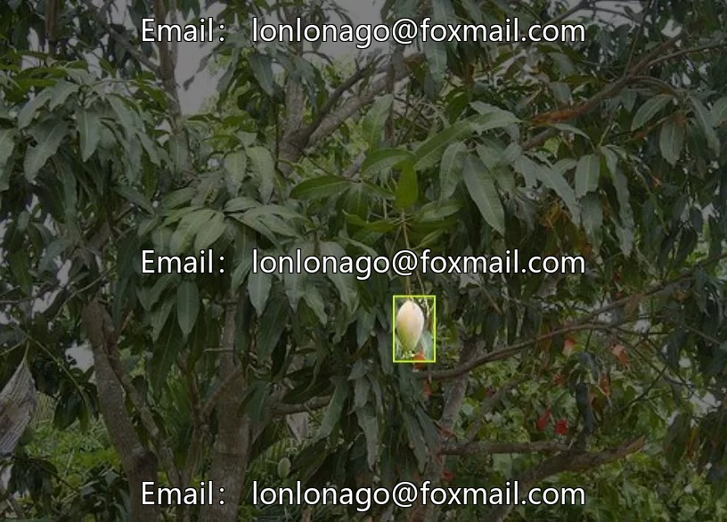
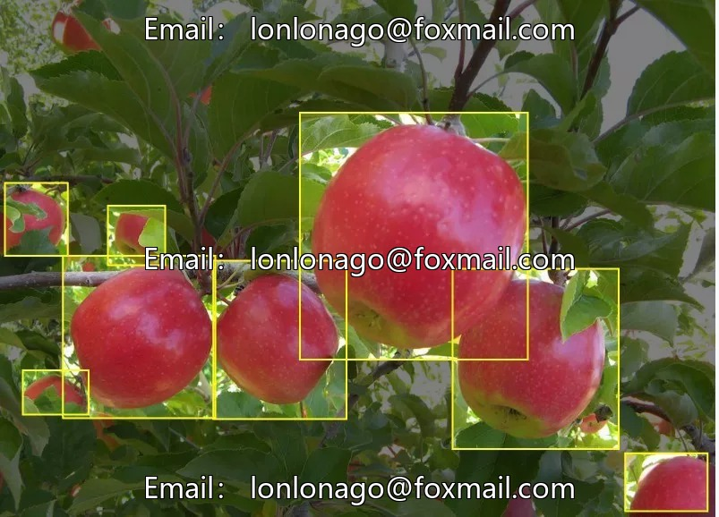
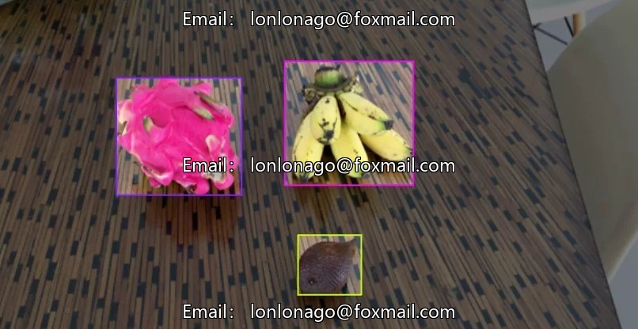
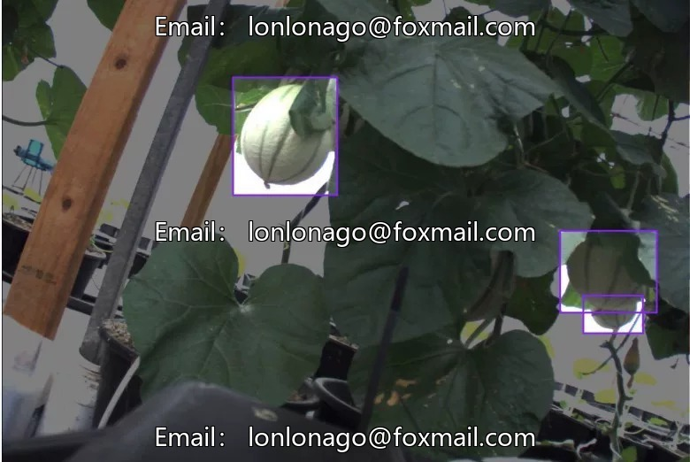
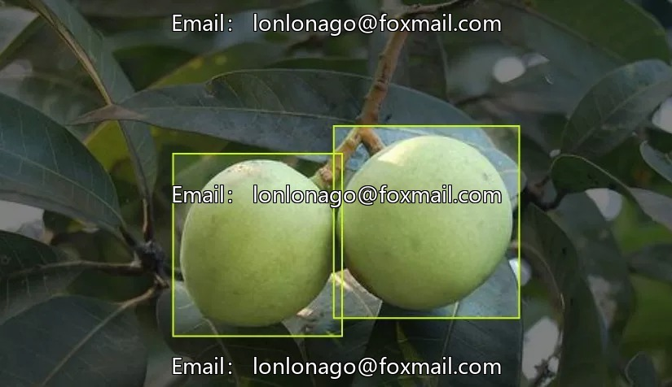

# Intelligent Agriculture Fruit Image Recognition Dataset, containing 5384 images, 19 common fruits

## Body

Intelligent Agriculture Fruit Image Recognition Dataset, containing 5384 images and 19 common fruit and vegetable categories.

Apple (Apple), Avocado (Avocado), Blueberry (Blueberry), Capsicum (Chili), Kiwi (Kiwifruit), Mango (Mango), Orange (Orange), Pink lady apple (Pink Lady Apple), Rockmelon (Pomegranate), Strawberry (Strawberry), Wheat (Wheat), banana (Banana), cherry (Cherry), dragon fruit (Dragon fruit), pineapple (Pineapple), snake fruit (Snake skin fruit), tomato (Tomato

The dataset is a target detection dataset in the field of computer vision, based on the YOLO architecture, comprising four datasets groups and supporting target detection models.
The data format is image files, supporting model training, testing, and performance verification.
It is suitable for scenarios such as intelligent sorting, fresh retail inventory management, and agricultural yield statistics, providing data support for fruit and vegetable recognition AI systems.
Model performance indicators: mAP@50 is 86.6%, precision rate is 89.6%, recall rate is 81.1% (under a 50% intersection over union threshold.
Virtual materials, once sold, are not available for refund.
Interested friends can click "I want" to proceed.

## Images

## Payment

Here is a pay link on Stripe ( https://buy.stripe.com/3cs8yP7sY87d0vu9AB ). Please contact me lonlonago@foxmail.com after funding $89, and I will send you a complete data files , thank you!

